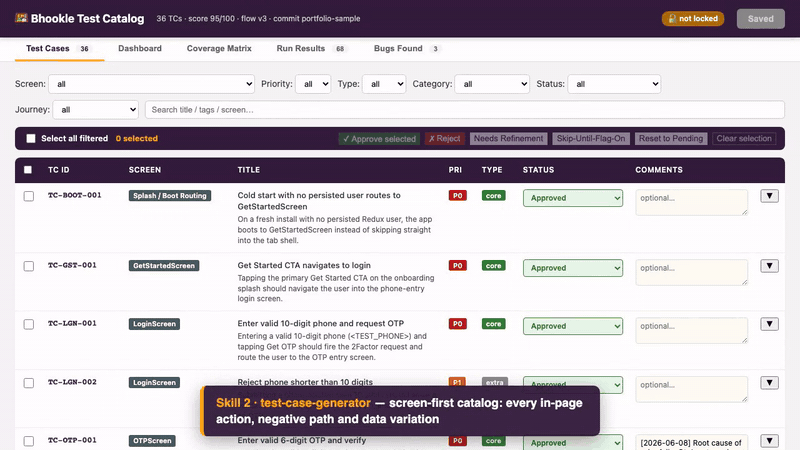
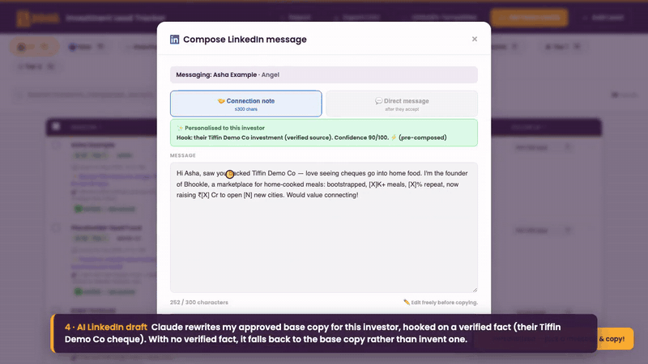

# AI Builder Portfolio — Arvind Ravichandran

**[🌐 Watch the demos](https://arvind-rgb.github.io/ai-portfolio/)** · [LinkedIn](https://www.linkedin.com/in/arvindbhookle) · [arvind2648@gmail.com](mailto:arvind2648@gmail.com)

I'm the founder of **Bhookle**, a home-cooked food marketplace in India. With no QA team, no growth team and no logistics team, I used **Claude Code** to build those teams as software. This repo collects four of those projects. Each folder has the code (with secrets and personal data removed), a README explaining the design, and a demo video recorded with sample data.

| | Project | What it does | AI at work | Demo |
|---|---|---|---|---|
| 🧪 | **[App Test Automation](app-test-automation/)** | Takes a React Native app from zero tests to a reviewed 191-case catalog, then compiles it into Maestro flows that run on an Android + iOS matrix in GitHub Actions | Three chained Claude Code skills: scan the code into screen maps, generate test cases, write and run the tests. Every claim is cited to `file:line`, and a person approves before anything runs | [▶ 1:40](_videos/app-test-automation.mp4) |
| 💸 | **[Fund Raiser](fund-raiser/)** | Investor-outreach CRM: finds the right angels, writes a personal first message to each, and tracks every touch | LLM lead scoring and gating, enrichment routing, and email/LinkedIn drafts in my own voice, written only from facts it has verified | [▶ 1:54](_videos/fund-raiser.mp4) |
| 🛵 | **[ShipHop.AI](shiphop-ai/)** | Multi-tenant last-mile portal: compares fares from 6 couriers, books the cheapest, tracks the rider live, reports spend. **In production** | Designed and built end to end with Claude Code, including integration work and hardening each adapter with parallel agents | [▶ 1:48](_videos/shiphop-ai.mp4) |
| 📣 | **[Marketing automation](marketing-automation/)** | An "AI marketing department" of 11+ skills: plan, create, review/lock, auto-publish to IG/LinkedIn, push notifications, email, Lemlist, ads analysis, competitor and kitchen intelligence | Claude-written copy and creative, brand-voice evals (100% vs 55% pass rate), and every human approval enforced in code | [▶ 2:23](_videos/marketing-automation.mp4) |

## Previews

| App Test Automation | Fund Raiser |
|---|---|
|  |  |
| **ShipHop.AI** | **Marketing automation** |
|  |  |

## How I build with AI

- **Pipelines of narrow steps, not one giant prompt.** Each step writes a durable artifact (a flow map, a catalog, a calendar) that the next step reads and that a person can review.
- **Humans approve, and the code enforces it.** Test cases, creatives, sends and spend all pass through explicit approve/lock gates.
- **Verify, don't trust.** Claims are cited to source, outreach drafts may only use facts that have been checked, and every integration is probed live before it counts as "connected".
- **Ship it.** These run on Firebase Functions, Cloud Scheduler, GitHub Actions, Render and Neon Postgres. They are working tools, not notebooks.

## A note on what's here

Everything in this repo has been sanitized. There are no keys, tokens or customer data. Investors, riders, chefs and phone numbers in the demos are fictional, and business figures are masked where noted. ShipHop.AI's production courier adapters are kept private.

## Contact

**Arvind Ravichandran** · [linkedin.com/in/arvindbhookle](https://www.linkedin.com/in/arvindbhookle) · [arvind2648@gmail.com](mailto:arvind2648@gmail.com)
