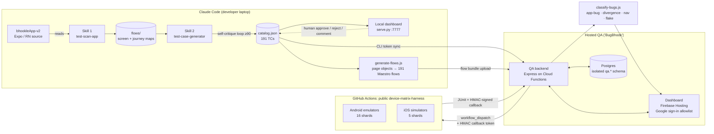

# App Test Automation: an AI QA pipeline for a React Native app


**[Watch the 100-second demo (MP4)](../_videos/app-test-automation.mp4)**

Three chained **Claude Code skills** that take the Bhookle consumer app (Expo + React Native, ~33 screens) from *"we have no tests"* to a reviewed 191-case test catalog. That catalog is compiled into Maestro flows and graded on an Android + iOS device matrix in GitHub Actions. I built it as a non-specialist founder with no QA team.

---

## The problem

Bhookle is a home-cooked food marketplace. The consumer app has a lot of logic hidden in screens: feature-flagged fulfilment modes, an address-anchored location gate, a single-chef cart, coupons, PhonePe hand-off, and a dormant subscription path. We had:

- **no QA engineer and no automated tests**. Releases were checked by hand on one phone.
- **stale docs.** The app's own CLAUDE.md said the OTP was 4 digits (it is 6) and that subscriptions were self-serve (that path is dead code behind a flag).
- **no budget** for device farms. Maestro Cloud is $250 per device per month.

## The approach

Treat QA as a pipeline of narrow, reviewable AI steps instead of one big prompt. Each step writes a durable artifact that the next step reads, and a human approves before anything runs.

| Stage | Skill | What Claude does | Output |
|---|---|---|---|
| 1. Understand | [`test-scan-app`](skills/test-scan-app/SKILL.md) | Reads the navigator and screen headers (header-only, to stay cheap), then maps every screen and transition. Each claim is cited to `file:line`. | [`screen-flow.md`](sample-state/flows/screen-flow.md), [`user-flow.md`](sample-state/flows/user-flow.md), [`journey-flow.html`](sample-state/flows/journey-flow.html) |
| 2. Design | [`test-case-generator`](skills/test-case-generator/SKILL.md) | Writes screen-first test cases (each in-page action, negative path and data variation), then **self-grades against a rubric** and loops until the score is ≥ 90/100. | `catalog.json` plus a review dashboard |
| 3. Execute | runner ([`runner/`](runner/)) | Compiles each test case into a Maestro flow from reusable page objects, shards the flows across a CI device matrix, ingests JUnit, and **classifies failures** before any developer sees them. | Graded runs + triaged bug list |

## Architecture



## How Claude is used, and where it is kept on a leash

- **Code-first reading, not guessing.** Skill 1 must cite `file:line` for every edge. It found three places where the docs were wrong (OTP length, the dormant subscription path, and an address screen that was assumed to be in checkout). These are recorded as "v3 corrections" in the flow map.
- **Self-critique as a gate.** The generator scores its own catalog against a [5-axis rubric](skills/test-case-generator/reference/self-critique-rubric.md): journey coverage, screen/in-page coverage, negative paths, data variation, and dormant-flag tagging. It fills gaps until the score is ≥ 90. The final score was 95/100.
- **Human in the loop.** I rejected the first 49-case catalog for covering only screen-to-screen navigation. That feedback is now a hard rule in the skill. Every test case can be approved, rejected or commented on in the dashboard. `refine` mode rewrites **only** the rejected rows and keeps approved ones verbatim. Execution needs a **lock** first.
- **Honest automation.** Each generated flow asserts the target screen's anchor `testID`, so a wrong navigation path fails the test instead of passing silently. Flows are tagged `proven`, `best-effort` or `external` (payment hand-off: the flow asserts the app is ready to pay and stops).
- **Root-causing, not retrying.** The first Android grade had 84 "Unknown error" failures. Claude traced them to a full `clearState` + OTP login on every test. A shared-session page object ([`ensure-landing.yaml`](runner/maestro/subflows/ensure-landing.yaml)) plus a single retry cut them to about 4.
- **Driving the app change.** Point-taps on in-card controls were swallowed by the card's touch handler, so Claude wrote a line-pinned `testID` spec (308 one-prop edits) for the app developer. After that, flows use `id:` selectors ([`auth-login.yaml`](runner/maestro/subflows/auth-login.yaml)).
- **Bug triage that respects developers' time.** [`classify-bugs.js`](cloud/qa-backend/scripts/classify-bugs.js) compares iOS and Android for each test. Only app bugs, regressions on proven flows, and true platform divergences reach the developer section. Automation-navigation misses and flakes go to my own fix list. When a developer rejects a bug, it is remembered **by signature** and suppressed on later runs.

## Key numbers

| | |
|---|---|
| Screens mapped / user journeys | 33 / 10 (+ supplementary) |
| Test cases | **191** (P0 36 · P1 94 · P2 58 · P3 3; core 102 · extra 89) |
| Self-critique coverage score | **95 / 100** (gate ≥ 90) |
| Generated Maestro flows | 191 (87 proven-navigation · 94 best-effort · 10 external hand-off) |
| Full Android run | **~6 min** on 16 parallel shards (vs ~5 h single-shard) |
| Android driver flakes | **84 → ~4** after the shared-session fix |
| Best consolidated grade | Android **145 / 191 PASS**; iOS 68 / 84 graded (partial) |
| Confirmed app bugs at last grade | 0. Remaining failures were automation navigation and CI infra, labelled honestly. 8 platform divergences queued for developer verification. |
| CI cost | **$0** (public runner repo = free Actions minutes; secrets never in the repo) |

### Status (honest)

- **Stages 1–2 are done and in use.** The catalog is reviewed in the hosted dashboard at **https://bhookle-qa.web.app** (sign-in restricted to allow-listed accounts).
- **Stage 3 (runner) is working but in progress.** Sharded CI, callbacks, grading, classification and triage are built and deployed. Still open: about 30 best-effort navigation chains need on-device verification, iOS runners on macOS are slow or flaky so the iOS grade is partial, and per-run divergence auto-flagging is not built yet.

## Security design (it is a public-facing pipeline)

- The CI harness repo is **public but brand-free**. It runs only on `workflow_dispatch` (no fork-PR triggers), `GITHUB_TOKEN` is read-only, and only two actions are allow-listed.
- Builds and flow bundles reach CI through **short-lived signed URLs**. Results come back with a **per-run HMAC token** (90-min TTL; only its SHA-256 is stored) — see [`callback-token.js`](cloud/qa-backend/src/lib/callback-token.js).
- The backend runs every query against an isolated `qa.*` schema (`search_path` forced on each connection). The schema-init script aborts if it detects drift in product tables.
- The dashboard uses Firebase Google sign-in and a server-side email allowlist. CLI helpers use a separate `X-CLI-Token` header.

## Repository layout

```
skills/
  test-scan-app/            Skill 1: SKILL.md + preflight scripts
  test-case-generator/      Skill 2: SKILL.md, dashboard.html, serve.py (stdlib), rubric, helpers
runner/maestro/
  generate-flows.js         catalog → Maestro flows (tiers, anchors, page objects)
  subflows/                 page objects: auth-login, ensure-landing, open-cart, …
  flows-sample/             36 generated TC flows matching the sample catalog
  smoke-ios.yaml            single-session smoke spine
  config.example.yaml       env file template (placeholders only)
sample-state/
  flows/                    real (sanitized) screen + journey maps produced by Skill 1
  testcases/catalog.json    SAMPLE: 36 of the 191 TCs; run results and bugs are illustrative
cloud/
  qa-dashboard/             hosted UI (static, Firebase Hosting): config.example.js
  qa-backend/               Express + pg on Cloud Functions: routes, HMAC callbacks, JUnit ingest, classifier
```

CI harness (already public): **https://github.com/arvind-rgb/device-matrix-harness**

## Run the dashboard locally (about 30 seconds, Python 3 only)

```bash
cd skills/test-case-generator
python3 scripts/serve.py --catalog ../../sample-state/testcases/catalog.json --port 7777 --no-browser
# open http://localhost:7777
```

Try the filters, expand a test case, change a status, and open the Coverage Matrix, Run Results and Bugs tabs. Save writes back to the sample `catalog.json`. The journey map is a static file: open `sample-state/flows/journey-flow.html` in a browser.

To run the skills themselves, copy `skills/*` into `~/.claude/skills/` and ask Claude Code to "scan the app" and then "generate test cases". The skills expect an Expo app repo and write to `~/.claude/skills/_bhookle-test-state/`.

## What was sanitized for this public copy

Test phone numbers, the OTP, the test account ID, chef names, coupon codes, team emails, the Firebase project and web config, database hosts, and Cloud Functions URLs were all replaced with placeholders. `.env` files, the local DB helper and lockfiles were left out. The real catalog has 191 test cases; the sample has 36.
