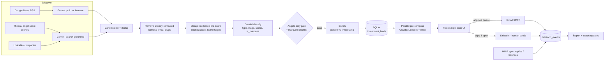

# Fund Raiser: AI investor-outreach tracker

I built this to run Bhookle's seed raise as a solo founder. It finds investors who might
actually back a home-food marketplace, writes a personal first message to each one in
my own voice, and tracks every touch until the investor replies or says no.


**Full walkthrough (about 2 min):** [`_videos/fund-raiser.mp4`](../_videos/fund-raiser.mp4)

> Every investor, firm, email address and LinkedIn URL in the demo and the seed script is
> made up (`@example.com`, `/in/demo-…`). The real tool runs on my own machine against a
> private database.

---

## The problem

Fundraising without a network turns into a spreadsheet of hundreds of names. Three things
went wrong for me:

1. **Wrong targets.** Most lists are full of VCs, growth funds and celebrity angels, and
   none of them answer a cold note about a pre-seed food startup.
2. **Generic messages.** Writing a real, personal note takes 10–15 minutes per investor.
   A template gets ignored, and an AI note that invents details ("loved your thesis on…")
   is worse than no note.
3. **No memory.** Who did I contact, on which channel, did it bounce, who is waiting for
   a follow-up, and why did the ones who said no say no?

## The approach

| Step | What happens | Where AI is used |
|---|---|---|
| **Find** | "Get More Leads" pulls funding news (Google News RSS), asks a search-grounded model targeted questions, and looks up investors in similar companies | Gemini (search-grounded) pulls the investor out of each headline and answers the scouting queries |
| **Filter** | An **angels-only gate** keeps India-based first-cheque writers in consumer, D2C or food. A **marquee blocklist** removes celebrity and top-brand investors. **Layered dedup** removes anyone, person or firm, I have already contacted | Gemini classifies each candidate (investor type, stage, sector, whether it is a marquee name) as structured JSON. Plain rules then make the pass/fail decision and give a 0–100 score and a Tier 1 or Tier 2 label |
| **Enrich** | People and firms go down different paths: for a person, find *their* profile; for a firm, find the right partner *at* the firm. Emails must pass an accept rule. **LinkedIn URLs are stored only if they appear in real search results. They are never generated** | Gemini search with strict checks before anything is accepted |
| **Write** | For each lead, Claude rewrites my approved base copy into a LinkedIn connection note (300 characters or fewer), a LinkedIn DM and an email | Claude Sonnet. It may use **only verified facts** (a portfolio company, a dated news hook). It returns JSON with a confidence score and the fact it used. If confidence is below 60 or no fact is given, the app uses my template unchanged |
| **Send** | LinkedIn: copy and open the profile, then I paste and send myself (LinkedIn has no send API). Email: Gmail SMTP with a review-and-approve queue and spaced-out sends | None. A human sends every message |
| **Track** | Every send, reply, bounce and status change goes into an append-only `outreach_events` log. IMAP sync moves leads to *Engaged* when they reply and to *No Response* after 5 days | Claude reads the notes on "Not Interested" leads and labels each one *Thesis / Portfolio / Traction / Scalability misfit*, so a later re-engagement message can respond to the actual objection |

Messages are **pre-written in parallel** right after leads are fetched and cached on the
row, so the compose window opens instantly. Writing live took about 8 seconds per click.

## Architecture



**Stack:** Python 3, Flask, Flask-SQLAlchemy on SQLite (WAL mode, so the parallel
pre-compose writers don't lock the UI), a single Jinja + vanilla-JS page, the Anthropic
SDK, the Gemini REST API, feedparser and BeautifulSoup. Playwright is optional, for
headless search.

### Files

| File | Role |
|---|---|
| `app/app.py` | Flask routes: leads CRUD, filters, compose and send, Gmail, IMAP sync, report, the Get More Leads job runner |
| `app/database.py` | Models: `InvestmentLead`, `EmailTemplate`, `OutreachEvent` |
| `app/getleads_engine.py` | Lead pipeline: discover → dedup → suppress → prescore → classify + gate → rank |
| `app/lead_sources.py` | Discovery adapters (news RSS, thesis queries, angel scout, lookalikes) |
| `app/lead_scoring.py` | Name canonicalisation, marquee blocklist, angels-only gate, tiering |
| `app/enrich_engine.py` | Contact enrichment with checks that reject guessed emails and URLs, investor verification, news hooks |
| `app/scraper.py` | Claude prompts: personalise email and LinkedIn, rewrite templates, classify rejections |
| `app/templates/index.html` | The whole UI |
| `app/seed_demo.py` | Builds a demo database with 25 fictional investors, 4 templates and about 30 outreach events |
| `demo/record_demo.py` | The Playwright script that recorded the video (blocks all outside traffic) |

## Lessons from running it on real leads

- **Never let a model guess a URL.** An early version let the model "find" LinkedIn
  profiles, and it made up believable slugs that led to 404s. Now a URL is stored only if
  it appears in a real search result.
- **Strict gates need a larger shortlist.** The angels-only gate passes about 1 in 8
  candidates. With a shortlist of `limit × 2`, whole batches came back empty. The fix was
  `shortlist = min(120, max(40, limit × 8))`, not a looser gate.
- **"I don't know" is a valid AI output.** The personaliser is allowed to say it has
  nothing to work with and return the template unchanged. A generic note is better than a
  personal note with a wrong detail.
- **LinkedIn blocks automated search,** so I kept a human in that step: the app opens the
  right profile, or a precise name + employer search, in my own browser.

## Run it locally (demo data, no keys needed)

```bash
cd fund-raiser/app
python3 -m venv .venv && source .venv/bin/activate
pip install -r requirements.txt
cp .env.example .env          # leave the keys blank to run in demo mode
python seed_demo.py           # creates instance/investment_leads.db with fictional data
PORT=5150 python app.py       # open http://127.0.0.1:5150
```

Without API keys, the leads, filters, pre-written AI drafts, templates and report all work.
Live re-writing falls back to your templates, and sending is disabled until Gmail is
configured. Add `ANTHROPIC_API_KEY` / `GEMINI_API_KEY` to enable live writing and lead
discovery.

## How the demo was recorded

The sanitised copy ran on port 5150 against the seeded fake database, with no API keys.
`demo/record_demo.py` drives Chromium through Playwright. It **aborts every request that
is not to localhost**, returns 403 for any send, OAuth, sourcing or enrichment endpoint,
and stubs the single live AI call shown (the "Write with AI" template rewrite) with a
sample response. The LinkedIn and email drafts on screen are the seeded pre-written
drafts. No emails were sent and no external service was called.

## What was removed for this public copy

The production repo also contains a private `.env`, the live investor database, pitch-deck
attachments, one-off data-repair scripts that held real contacts, and an unrelated
delivery-booking module. None of these are included. The hardcoded seed lists and the
marquee blocklist named real investors, so they were replaced with fictional placeholders.
Bhookle's real traction and fundraising figures (meals, chefs, GOV, raise size, cities) in the
default copy and demo drafts are masked as `[X]` / `[N]` / `[City A]` placeholders.
The logic is otherwise unchanged.
