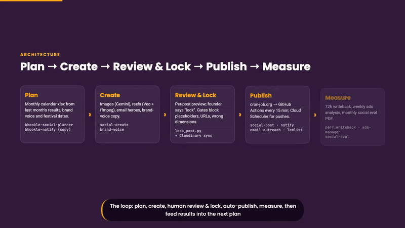
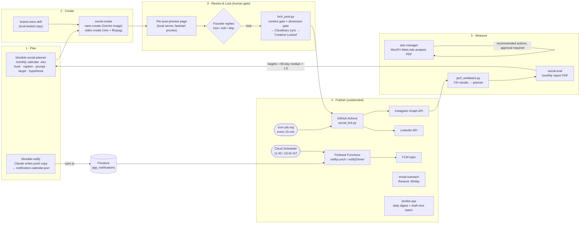

# Marketing skills & automation: an AI marketing department for Bhookle

Bhookle is a home-cooked food marketplace in India. Home chefs cook, customers order through the app. I'm the founder, and there is no marketing team. Instead I built one out of **Claude Code skills, GitHub Actions, Firebase Cloud Functions and a few small Python/Node workers**. Together they plan, create, review, publish and measure Bhookle's marketing. A person (me) approves every creative, message and spend decision, and every one of those approvals is enforced in code.

[](../_videos/marketing-automation.mp4)

**Demo video (2 min 23 s):** [`_videos/marketing-automation.mp4`](../_videos/marketing-automation.mp4). It walks through each automation using sanitized artifacts and includes live footage of the Kitchen Intel portal running locally with a sample report.

---

## At a glance

| | |
|---|---|
| **27 / 27** | posts in the Jul–Aug 2026 calendar were reviewed, locked and **auto-published with no manual posting** (18 Instagram + 9 LinkedIn) |
| **2 per day** | Claude-written app push notifications, sent on the minute (11:45 and 18:45 IST) by Cloud Scheduler. Live since Jun 2026, with about 230 slots planned |
| **781** | devices reached by one targeted "₹100 off your first meal" push to registered-but-never-ordered users (2,007 unique tokens, 0 send errors) |
| **39 %** | token freshness on a month-old segment. **What it means:** activation has to happen within days of signup, not weeks. That finding changed the follow-up design |
| **100 % vs 55 %** | brand-voice eval pass rate with the skill vs. without it (4 prompts × 3 runs) |
| **15 min** | publish tick, triggered externally (cron-job.org → `repository_dispatch`). GitHub's own cron drifted and skipped runs |

---

## How content flows



Design choices that recur across the system:

- **External trigger, idempotent worker.** cron-job.org fires `repository_dispatch`. Each worker is safe to run twice: posted-log, status flip, per-day output markers, and `reactivation_log` in Firestore.
- **Plan in git, live state elsewhere.** The calendar JSON/xlsx in the repo is the plan. Firestore holds what actually happened (scheduled → posted).
- **Gates in code, not in docs.** `lock_post.py` refuses placeholders (`[VERIFY]`, `[TBD]` …), banned words, URLs in captions and wrong aspect ratios. `lint_calendar.py` refuses duplicate or over-long push titles.
- **Watchdogs for the human part.** The notification runway check emails me when fewer than 5 days of copy are armed. It was added after one week ran dry. Lemlist completion detection and the Meta wallet check work the same way.
- **Nothing irreversible runs on its own.** Lemlist creates *draft* batches. Ads actions need approval. Push blasts default to `dry_run=true`.

---

## Every skill and automation

The ✅ rows have code in this folder. The rest are listed for completeness.

| # | Skill / automation | What it does | Stack | Trigger / schedule | Status | In this folder |
|---|---|---|---|---|---|---|
| 1 | **bhookle-social-planner** | Builds a month's content calendar (.xlsx) with per-post hook, caption, hashtags, generation prompt, eval target and hypothesis. Reads last month's performance | Claude skill · Python · openpyxl | On demand, monthly | Used for each month's calendar | ✅ [`social-planner/`](social-planner/) |
| 2 | **social-create** (nano-create, video-create) | Generates images and reels for planner rows. Storyboard → approve → generate → lock. Includes a reel builder, thumbnailing and a credit-aware engine choice | Gemini 2.5 Flash Image · Veo · ffmpeg · Python | On demand | Live | ✅ [`social-create/`](social-create/) |
| 3 | **Content review and lock loop** | Per-post preview page (video/carousel plus copy, target, hypothesis). Founder replies lock/edit/skip, then `lock_post.py` runs the gates and syncs to Cloudinary | Python · local HTTP server with Range support · ffmpeg | Per post | Live, used for 27/27 posts in Aug 2026 | ✅ `social-post/scripts/lock_post.py` |
| 4 | **social-post** | 15-minute tick posts due planner rows to Instagram and LinkedIn, with 3-layer idempotency and a failure email | Python · GitHub Actions · cron-job.org · Cloudinary · Meta Graph API · LinkedIn API | Every 15 min | Ran the Jun–Aug 2026 calendars. Tokens need re-auth every ~60 days | ✅ [`social-post/`](social-post/) |
| 5 | **Performance writeback** | Writes 72h likes/comments vs. target into the planner and appends follower growth to a log | Python · Graph API · GitHub Actions | Daily 23:00 IST | Live | ✅ `social-post/scripts/perf_writeback.py` |
| 6 | **bhookle-notify** | Claude writes twice-daily push copy in a "mother's voice". Calendar → Firestore → Cloud Scheduler + Functions → FCM, on the minute. Linter, weekly FYI email, runway watchdog | Firebase Functions (Node) · Cloud Scheduler · Firestore · FCM HTTP v1 · Python · GitHub Actions | 11:45 and 18:45 IST | Live since 19 Jun 2026 | ✅ [`bhookle-notify/`](bhookle-notify/) |
| 7 | **Segment push + reactivation function** | Per-token FCM blast with dry-run/canary (781 delivered). A follow-up Cloud Function sends the offer to yesterday's registered-not-ordered users once ever | Python · Node Cloud Function · Firestore | Manual dispatch / 11:00 IST | Blast done. Function built, waiting for backend query + deploy | ✅ `bhookle-notify/scripts/send_tokens.py`, `cloud-functions/followup.js` |
| 8 | **email-outreach** | Campaign interview → AI hero image → audience ingest → send plan → paced daily dispatch → daily stats digest with master workbook | Python · Resend (Brevo fallback) · Cloudinary · GitHub Actions | Dispatch 10:30 IST, stats 07:00 IST | Live | ✅ [`email-outreach/`](email-outreach/) |
| 9 | **lemlist-ops** | Daily B2B campaign digest, completion detection, auto-created draft for the next 100-lead batch (ICP filters, deduped against all prior batches) | Python · Lemlist REST · Gmail SMTP · GitHub Actions | Daily 19:00 IST + on completion | Live | ✅ [`lemlist-ops/`](lemlist-ops/) |
| 10 | **ads-manager** | Meta Ads analyst: insights pull, creative-fatigue scoring, branded PDF and JSON recommendations, approval-gated API actions, wallet alerts, lead-form forwarding | Python · Meta Marketing API · ReportLab · GitHub Actions | Mon 16:00 + Fri 10:00 IST, wallet every 6h | Live, 39 reports since May 2026 | ✅ [`ads-manager/`](ads-manager/) |
| 11 | **social-eval** | Monthly Instagram/Facebook evaluation: 7 sections, 6 charts, competitor benchmark, priorities. Its July retro reset inflated targets | Claude skill · Windsor.ai MCP · web research · ReportLab · matplotlib | Monthly | Used for the May and Jul 2026 reports | ✅ [`social-eval/`](social-eval/) (with a synthetic sample PDF) |
| 12 | **kitchen-intel** + portal | Research agent profiles a home kitchen on Zomato/Swiggy/Google and builds an 11-section chef-shareable report (HTML + PDF). A portal queues requests as GitHub issues | Claude Code · browser automation · Python HTML builder · headless Chrome · GitHub Pages | On request (issue queue) | Live, 4 reports published | ✅ [`kitchen-intel/`](kitchen-intel/) (with sample report) |
| 13 | **agent-zoya-for-zomato** | Onboards a chef onto Zomato: menu audit, commission gross-up pricing, upload CSV, chef pricing-sheet PDF, competitor check, duplicate-listing test, hero-image brief | Claude skill · Python · ReportLab · Pillow | On demand | In use | ✅ [`agent-zoya-for-zomato/`](agent-zoya-for-zomato/) |
| 14 | **bhookle-brand-voice** | Brand voice guide and examples per channel, eval-tested (100% vs 55% pass rate) | Claude skill · skill-creator evals | Used by other skills | Live | ✅ [`brand-voice/`](brand-voice/) |
| 15 | **genb2bleads** | B2B corporate-food lead sourcing (funding DB → Google → LinkedIn), a daily DM brief for phone outreach, a reply listener and a 5 pm report | Python · Gmail · GitHub Actions | Daily | Built | Not included (operates on lead lists) |
| 16 | **bhookle-market-research** | Market sizing and competitor intelligence PDF | Claude skill · ReportLab | On demand | Built | Not included (report data) |
| 17 | **bhookle-pptx** / **bhookle-design-system** | Branded deck builder and the design system (tokens, logos, UI kit) other skills render with | python-pptx · CSS tokens | Used by other skills | Live | Not included (60–90 MB of brand binaries) |
| – | bhookle-seo / bhookle-seo-eval | Adds and audits SEO metadata, JSON-LD and sitemaps on the Next.js web app | Claude skill | On demand | Built | Not included (web-app specific) |
| – | Bhookle Kids quote portal | Ops quote wizard that makes a WhatsApp-shareable invoice image with a UPI QR | Single-file HTML · html2canvas | Ops use | Live: [arvind-rgb.github.io/bhookle-kids-quote](https://arvind-rgb.github.io/bhookle-kids-quote/) | Not included (already public) |
| – | Zomato chef-invoice skill | Spec for invoicing Bhookle's share back to chefs from Zomato settlement reports, plus a reference implementation | Python · openpyxl | Monthly | Spec / in progress | Not included (built on real settlement data) |
| – | higgsfield-* | Third-party video-generation skills, opt-in only and credit-checked before use | Vendor skills | – | Rarely used | Not included (not my code) |

---

## Folder guide

```
marketing-automation/
├── README.md
├── .env.example                 # every variable the scripts read (placeholders only)
├── social-planner/              # SKILL.md, Excel spec, prompt library, build_calendar.py
├── social-create/               # nano-create (images) + video-create (reels) skills and scripts
├── social-post/                 # tick worker, IG/LI posters, lock gate, Cloudinary sync, perf writeback
│   └── workflows/               # bhookle-social-tick.yml, bhookle-perf-writeback.yml
├── bhookle-notify/
│   ├── cloud-functions/         # index.js / notify.js / sync.js / followup.js (Firebase Functions)
│   ├── scripts/                 # calendar lib, linter, runway watchdog, FCM client, segment blast
│   ├── workflows/               # sync + FYI preview + watchdog; dry-run-by-default blast
│   └── sample-calendar.json     # 2 past weeks of real (already sent) copy
├── email-outreach/              # Resend/Brevo dispatch, stats digest, hero image, workflows
├── lemlist-ops/                 # daily digest, completion detection, next-batch drafting
├── ads-manager/                 # analysis framework, report builder, approval-gated API actions
├── social-eval/                 # report builder + sample/ (synthetic input JSON and PDF)
├── kitchen-intel/               # skill, data playbook, report builder, portal/, sample-report/
├── agent-zoya-for-zomato/       # Zomato onboarding skill: pricing, CSV, chef PDF, image prep
└── brand-voice/                 # brand voice skill + evals and benchmark
```

Workflow files live in `<skill>/workflows/` here. In the source repo they sit in `.github/workflows/`, so the paths inside them (`_skills/...`, `content-planner/...`) refer to that repo's layout.

## Sanitization notes

This is a curated, sanitized copy of a private repo. Here is what was removed:

- **Secrets.** Every token, key and service account was removed. Code reads from environment variables and GitHub secrets (see `.env.example`). One hard-coded API-key fallback was replaced with an empty default.
- **Account identifiers.** Ad account, ad set, page, lead-form and LinkedIn org IDs, the Cloudinary cloud name and the Firebase project ID are now `<PLACEHOLDER>` values. Email addresses are now `@example.com`.
- **Personal data.** No customer, chef or lead data appears anywhere. Real chef names in examples were replaced with "Sample" names. The kitchen-intel report and the social-eval PDF shown are a **sample kitchen** and **synthetic data**.
- **Content plans and performance.** The real content calendar, the ad performance reports and the lead lists are not published. The push-notification excerpt covers two past weeks that have already been sent.
