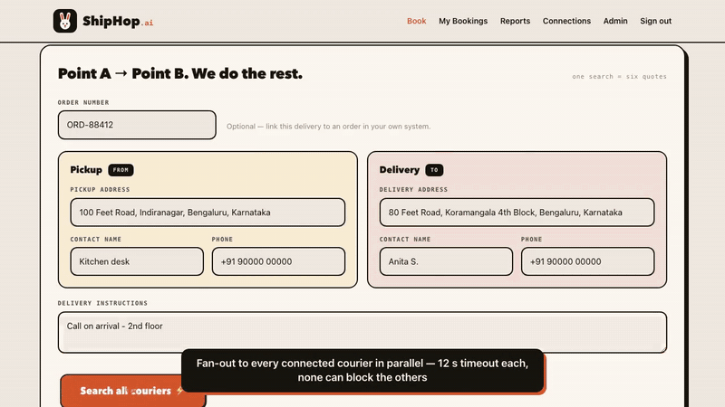
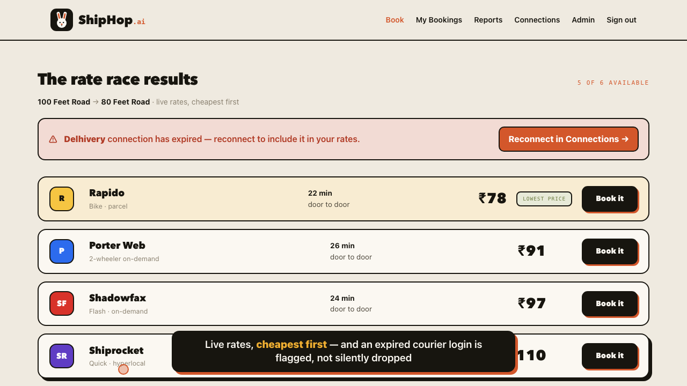
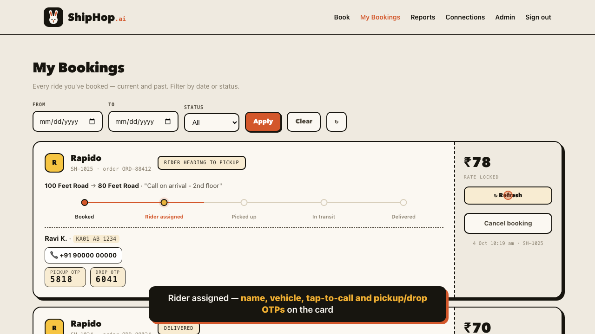
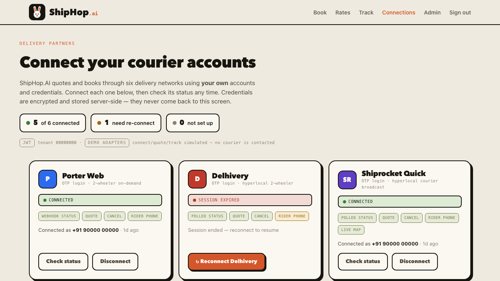
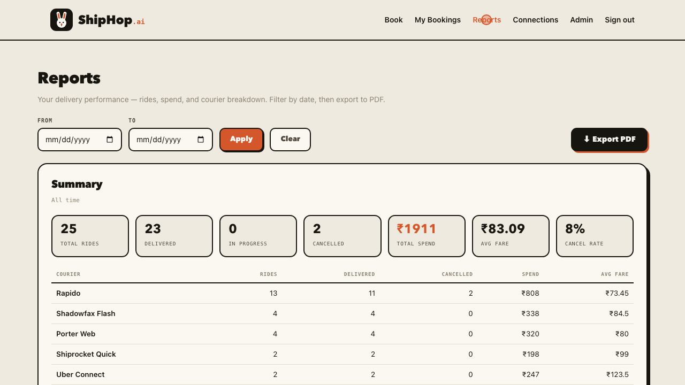
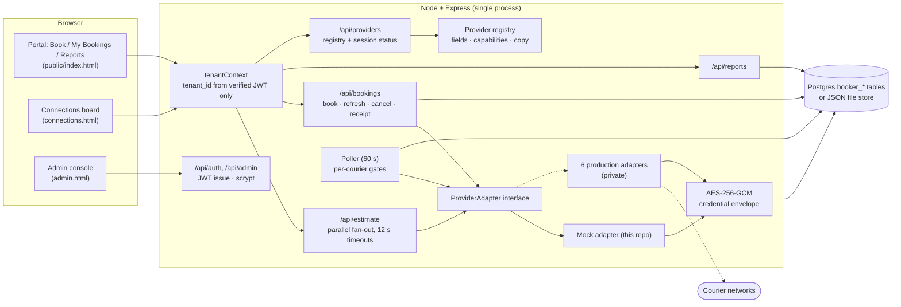

# ShipHop.AI — make couriers compete for your parcel

**One search across six last-mile courier networks → book the cheapest → track the rider → report on spend.**
A multi-tenant web portal I designed and built end-to-end with Claude Code, now running in production.



- **Demo video (108 s):** [`_videos/shiphop-ai.mp4`](../_videos/shiphop-ai.mp4)
- **Live:** https://shiphop-ai.onrender.com (login-gated; operator accounts are issued by the admin)
- **Run it locally in one command:** `cd server && npm install && npm run demo`, then go to http://localhost:8890

> **What this repo includes, and what it leaves out.** This is a showcase of the platform: the UI, the
> multi-tenant server, auth, encryption, tenancy, polling, reporting and the provider *interface*. The
> six **production courier adapters are kept private**, so they aren't here. They integrate with courier
> apps that have no public API, and publishing those details wouldn't be appropriate. In their place,
> [`server/src/providers/mock`](server/src/providers/mock/index.js) is a complete reference adapter, so the
> whole flow works end-to-end without contacting any courier.
>
> *ShipHop.AI is an independent project and is not affiliated with, or endorsed by, any of the courier brands named here. Fares and riders in the demo are simulated.*

---

## The problem

In Indian cities, small businesses such as cloud kitchens, bakeries, grocers and D2C brands send parcels
across town every day. No single courier is reliably cheapest or available. On one route Rapido wins, on
the next it's Porter, and at 8 pm only Shadowfax has riders. So operators keep **six courier apps**
on their phones. For each order they re-type the same pickup and drop into each app, compare the prices
in their heads, book in one app, and then chase the rider's OTP and phone number in that app's own tracking
screen. It is slow and error-prone, and it gives no view of overall spend.

## The solution

ShipHop.AI puts all of that behind one screen:

1. **Connect once.** Each business links its *own* courier accounts with a mobile-number OTP login.
2. **Search once.** One pickup and drop entry gets live quotes from every connected courier in parallel,
   sorted cheapest-first, in about 5 seconds.
3. **Book in one click.** The winning courier is booked through its adapter. The order id, fare and OTPs
   are captured.
4. **Track without touching the courier app.** The courier's own status, the rider's name and vehicle,
   tap-to-call and pickup/drop OTPs all appear on one card and update automatically.
5. **Report.** Rides, spend, average fare, cancellation rate and a per-courier breakdown, with one-click
   PDF export.

## Features

| | |
|---|---|
| **Rate sweep, cheapest-first** | `POST /api/estimate` fans out to every adapter with `Promise.allSettled` and a 12 s timeout per courier. One slow or broken courier never blocks the others. "A dead session is not a dead route": an expired login is reported, not silently dropped. |
| **One-click booking** | Booking goes through the same adapter interface for every courier and is stored in a courier-agnostic `booker_booking` table, with the courier-specific ids kept in a JSON blob. |
| **Live rider / OTP / tracking** | The card shows the courier's own status string, a 5-step stepper, rider name, vehicle, tap-to-call, and pickup and drop OTPs, depending on what each courier exposes (declared as *capabilities* in the registry). |
| **Auto-polling** | A 20 s client refresh for open cards plus a 60 s server poller with **independent per-courier gates**, so one rate-limited courier can't stall the rest. An expired session breaks only that courier's batch. |
| **Reconnect UX** | Expired sessions show up in three places: a banner on the rates screen, a red tile on the Connections board, and a one-tap **Reconnect** button. A connection only counts as live once a real fare check passes, not just because a token is on file. |
| **Reports + PDF** | Aggregates work the same on Postgres or the file store. The PDF is generated in the browser by a ~2 KB dependency-free writer ([`public/vendor/pdfmini.js`](public/vendor/pdfmini.js)). |
| **Multi-tenant admin** | The admin creates a tenant (a business) and gets a one-time operator credential. Only a scrypt hash is stored. |
| **Tenant isolation** | `tenant_id` comes **only** from a verified JWT, never from a client header. Every query is scoped by tenant. |
| **Encrypted credentials** | Courier sessions are stored as an AES-256-GCM envelope (`{v, iv, tag, ct}`). They are never logged and never returned to the browser. The `encrypt`/`decrypt` interface is ready for a KMS-wrapped key later. |
| **Registry-driven UI** | [`registry.js`](server/src/providers/registry.js) declares each courier's login fields, capabilities and help copy. The Connections screen renders entirely from `GET /api/providers`, so the UI can't drift from the backend. |
| **Zero-config demo** | No database means a JSON file store. No Maps key means a built-in demo address book. No adapters means the mock adapter is used. |

## Screenshots

| Rate sweep | Live tracking |
|---|---|
|  |  |
| **Connections board** | **Reports** |
|  |  |

## Architecture



**Request path for a quote:** the browser sends `POST /api/estimate` with a JWT. `tenantContext` resolves
the tenant. The estimate route snapshots each courier's session state and calls `adapter.estimate()` on
all six in parallel. The results are normalised and ranked: priced first, then bookable, then unavailable.
Any courier that reports an expired session gets `markExpired()`, which also turns its Connections tile red.

**Data model** ([`migrations/booker_0001_init.sql`](server/migrations/booker_0001_init.sql)):
`booker_tenant`, `booker_operator_auth` (scrypt), `booker_provider_session` (one encrypted row per
tenant × courier), `booker_booking` (canonical status vocabulary plus a courier blob), and `booker_estimate`.
These tables are deliberately kept apart from the consumer-order table in the same database. That table
fires a notification worker, and those side-effects must never fire for a third party's parcel.

### Repo layout

```
public/                    the portal UI (vanilla HTML/CSS/JS, no build step)
  index.html               Book · My Bookings · Reports ("Kinetic Bento" design)
  connections.html         courier connection board
  admin.html               tenant + operator management
  vendor/pdfmini.js        tiny PDF writer for report export
server/
  src/app.js               bootstrap, static hosting, route mounting
  src/auth.js              JWT tenant + admin guards
  src/crypto.js            AES-256-GCM credential envelope
  src/pwd.js               scrypt password hashing
  src/db.js                Postgres store + zero-dependency file-store fallback
  src/poller.js            per-courier status poller
  src/routes/*.js          auth, admin, providers, estimate, bookings, reports, places
  src/providers/adapter.js the ProviderAdapter interface
  src/providers/registry.js courier metadata driving backend + UI
  src/providers/mock/      reference adapter (fake fares, fake rider, full lifecycle)
  migrations/              booker_* schema
  scripts/demo.js          one-command demo (ephemeral secrets + seeded data)
```

## Running it

```bash
cd server
npm install
npm run demo          # → http://localhost:8890
```

The demo generates throwaway secrets, seeds a demo tenant, connects five couriers (one has a
deliberately expired session so you can try Reconnect) and adds two weeks of booking history.
Every name, number and address is fictional.

| | Login | Password |
|---|---|---|
| Operator portal (`/`, `/connections`) | `demo-kitchen` | `shiphop-demo` |
| Admin console (`/admin`) | `admin@shiphop.test` | `shiphop-admin` |

In demo mode no SMS is sent, so any 6-digit OTP connects. `MOCK_STEP_SECONDS` (default 30) controls how
fast a booking moves through the stages. For a real deployment, copy [`server/.env.example`](server/.env.example)
to `.env` and set `DATABASE_URL`, `BOOKER_CRED_KEY`, `BOOKER_JWT_SECRET` and the admin credentials.

## How I built it with AI

I'm the founder of a home-food marketplace, not a full-time engineer. I built ShipHop.AI with
**Claude Code** as my pair-programmer, from the first UI concept to a production deployment. How the work
was split:

- **Design first, frozen early.** Claude produced three UI concepts. I picked one ("Kinetic Bento") and
  froze it. All later backend work plugged into fixed integration points in the page, so the UI never
  regressed while the backend changed underneath it.
- **Architecture by constraint.** I wrote the rules in plain English: never let the client assert its
  tenant, encrypt credentials at rest, keep these tables away from the consumer order worker, and a dead
  session is not a dead route. Claude turned each rule into code: the JWT-only `tenantContext`, the
  AES-GCM envelope, the isolated `booker_*` schema and the estimate ranking.
- **Courier integration.** None of these couriers offers a public booking API for small businesses. I
  started from an earlier developer's handoff: standalone per-courier service code plus a checklist of
  known pitfalls. With Claude I mapped that code onto one `ProviderAdapter` interface, and where the
  existing code fell short, we analysed how the courier's own web or mobile client talks to its backend. Each courier had its own login and session model, so the
  connect flow had to be solved separately for each one. Those adapters are the private part of the system.
- **Hardening with parallel agents.** Once all six adapters worked, I ran several Claude Code agents
  in parallel, one per courier, each focused on a single question: what happens when this courier's
  session expires, rate-limits, returns an unexpected status, or times out mid-booking? Their findings
  led to the per-courier poller gates, the batch-break on expiry, the "live fare check before we call
  it connected" rule, and the three-place reconnect UX.
- **Verification in a real browser.** Every feature was checked by driving the actual UI with Playwright,
  not just by unit tests. The demo video for this repo was recorded the same way, against the mock adapter.
- **Shipping.** Claude wrote the Postgres migration, the file-store fallback, the Dockerfile and the deploy
  configuration. The app runs on a free Render web service with Neon Postgres.

**What I take from this:** with the right constraints and a habit of checking every result, one
non-specialist with Claude Code can ship a multi-tenant, security-conscious integration product that
would normally need a small team.

## Honest limitations

- The courier integrations depend on clients the couriers control, so they can break whenever a courier
  changes its app. Isolating them behind adapters, using capability flags and adding the reconnect UX are
  ways to limit that risk, not remove it.
- Some couriers expose less than others (for example masked rider numbers, or no drop OTP). The UI shows
  what each courier actually provides instead of making up the rest.
- The demo's fares, ETAs and status progression are simulated by the mock adapter.
